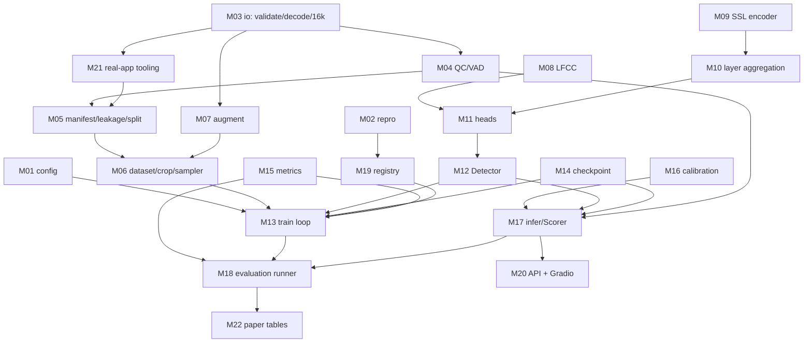

# VaaniShield — Architecture Blueprint (v1)

Status: **design only**, no code exists yet. Date: 2026-10-07.

This document builds on `PROJECT_STATE.md` (DEC-*), `research/technical_decisions.md` (TD-*) and `research/research_gap.md` (H1–H13). Interfaces here are normative: code must match them, or this document must be changed first, with the change recorded in PROJECT_STATE §5.

## 1. Pipeline overview

```
            ┌──────────────── offline (once per source clip) ────────────────┐
raw file ─► M03 validate ─► M03 decode ─► M03 to_mono_16k ─► M04 QC/VAD ─► processed WAV + QC row
            └─────────────────────────────────────────────────────────────────┘
                                         │  (manifest row, M05)
            ┌──────────────── online (per training / scoring example) ───────┐
            M06 load ─► M06 crop/pad (deterministic) ─► M07 augment (TRAIN ONLY)
                      ─► M09 encoder (XLS-R, 25 hidden states)
                      ─► M10 layer aggregation (softmax weights)
                      ─► M11 head (AASIST-lite | attentive-stats MLP)
                      ─► logits[B,2] ─► spoof_logit
            └─────────────────────────────────────────────────────────────────┘
inference only:  M17 windowing ─► per-window spoof_logit ─► M16 calibration ─► p_spoof
                 ─► segment timeline ─► clip aggregation ─► decision at dev-fixed threshold ─► M20 API
```

Baselines replace M09+M10+M11 with:
- **B0:** M08 LFCC → LCNN head.
- **B1:** the vendored AASIST, which takes raw waveform through its own sinc front end.

Every model exposes the same `Detector` interface (§4.6), so training, evaluation, inference and the API never branch on model type.

## 2. Conventions (apply everywhere)

| Item | Convention |
|---|---|
| Labels | `bonafide` = 0, `spoof` = 1 (DEC-1) |
| Score | `spoof_logit = logits[:,1] - logits[:,0]`; higher = more likely spoof |
| Probability | `p_spoof = sigmoid(spoof_logit / T_c)` after calibration (M16) |
| False alarm | bona fide decided spoof. **Miss** = spoof decided bona fide |
| Audio in memory | `np.float32` or `torch.float32`, shape `[T]` (single clip) or `[B, L]` (batch), range [-1, 1], sample rate **16000** |
| Crop length | `L = 64600` samples (~4.04 s, TD-3); inference hop `32300` (50 % overlap) |
| Paths | always relative to `VAANI_DATA_ROOT`; never absolute in manifests |
| Randomness | every stochastic function takes an explicit `np.random.Generator` or `torch.Generator`; no global RNG calls inside library code |
| Units | seconds as `float`, sample counts as `int`, bitrates in kbps as `int` |

## 3. Package layout

> **As built in Phase 1 (supersedes the tree below where they differ):**
> - The code lives in `ml/src/{datasets,models,augment,metrics,utils}/` plus `ml/src/train.py` and `ml/src/evaluate.py`, following the project-guide layout. `pyproject.toml` maps the import name `vaanishield` onto `ml/src/` (DEC-15). So `vaanishield.datasets` = `ml/src/datasets/`, with no clash with Hugging Face `datasets`.
> - Module homes:
>   - M01 config, M02 repro, M19 registry → `utils/config.py`, `utils/repro.py`, `utils/registry.py`
>   - env info → `utils/env_info.py`
>   - M15 → `metrics/core.py`
>   - M05/M06 → `datasets/`
>   - M08–M12 → `models/`
>   - M07 → `augment/`
>   - M03/M04/M16/M17/M18/M21 → new subpackages added under `ml/src/` when built, registered in `pyproject.toml`
> - **No torchaudio (DEC-14):**
>   - M03 decodes with soundfile (WAV/FLAC) and an ffmpeg subprocess (others), and resamples with `soxr` (HQ).
>   - M08 LFCC uses `torch.stft`.

```
ml/src/vaanishield/
├── config/        M01  schemas.py (pydantic), load.py, hashing.py
├── repro/         M02  seed.py, env.py (env capture), git.py, hashing.py
├── io/            M03  validate.py, decode.py, resample.py
├── qc/            M04  metrics.py, vad.py, report.py
├── data/          M05  manifest.py, validate.py, leakage.py, splitter.py, stats.py
│                  M06  dataset.py, cropping.py, sampler.py, collate.py
├── augment/       M07  codec.py, rawboost.py, langmix.py, resample_chain.py, pipeline.py
├── features/      M08  lfcc.py
├── models/        M09  encoders.py      M10 aggregation.py
│                  M11  heads/{lcnn.py, aasist_lite.py, attn_stats.py}, vendored/aasist/ (+LICENSE, pinned commit)
│                  M12  detector.py, factory.py
├── train/         M13  loop.py, losses.py, optim.py, early_stop.py
├── checkpoint/    M14  io.py
├── metrics/       M15  eer.py, threshold.py, calibration_metrics.py, tdcf.py, bootstrap.py, slices.py
├── calibration/   M16  temperature.py, conditional.py, channel_estimator.py
├── infer/         M17  windowing.py, scorer.py, warnings.py
├── evaluation/    M18  runner.py, test_lock.py, reports.py
├── registry/      M19  run.py (RunContext), manifest_json.py
├── channel/       M21  realapp_pairing.py, ffprobe.py
└── cli.py              entry points (§7)
ml-service/app/    M20  main.py (FastAPI), schemas.py, gradio_ui.py, limits.py
paper/tools/       M22  make_tables.py, make_figures.py
tests/             M23  unit/, integration/, fixtures/ (tiny synthetic audio only)
```

## 4. Module definitions and exact interfaces

Signatures are Python 3.12 type hints. `Tensor` = `torch.Tensor`.

### 4.1 M01 `config`: typed configuration
- **Responsibility:** load YAML, validate with pydantic, compute `config_sha256` over canonical JSON (sorted keys).
- **Interface:**
  ```python
  class DataCfg(BaseModel): train_manifests: list[str]; dev_manifests: list[str]; test_manifests: list[str]; crop_samples: int = 64600; num_workers: int = 4
  class AugCfg(BaseModel): enabled: bool = False; p_codec: float = 0.0; codecs: list[CodecSpec] = []; p_rawboost: float = 0.0; rawboost_algo: list[int] = []; p_langmix: float = 0.0; langmix: LangMixCfg | None = None; p_resample: float = 0.0
  class ModelCfg(BaseModel): kind: Literal["lfcc_lcnn","aasist","xlsr_mlp","xlsr_aasist_lite","w2v2en_aasist_lite"]; encoder_id: str | None; freeze_encoder: bool = True; unfreeze_top_k: int = 0; aggregation: Literal["weighted","last","fixed_layer"] = "weighted"; fixed_layer: int | None = None; adapter_dim: int = 128; truncate_after_layer: int | None = None
  class TrainCfg(BaseModel): seed: int; epochs: int = 20; batch_size: int = 8; grad_accum: int = 4; lr_head: float = 1e-4; lr_encoder: float = 1e-6; weight_decay: float = 1e-4; amp: bool = True; early_stop_patience: int = 5; class_weights: tuple[float,float] | None = None; max_grad_norm: float = 1.0
  class CalibCfg(BaseModel): method: Literal["none","global_temp","conditional_temp"] = "global_temp"; dev_conditions: list[str] = ["clean"]
  class ExperimentCfg(BaseModel): exp_id: str; hypothesis_ids: list[str]; data: DataCfg; aug: AugCfg; model: ModelCfg; train: TrainCfg; calib: CalibCfg
  def load_config(path: str) -> ExperimentCfg
  def config_hash(cfg: BaseModel) -> str
  ```
- **Depends on:** none.

### 4.2 M02 `repro`: reproducibility primitives
```python
def seed_everything(seed: int, deterministic: bool = True) -> None   # python, numpy, torch, cuDNN flags
def capture_env() -> dict          # implemented as utils/env_info.collect_environment(): python, OS, CPU, RAM, torch/CUDA/GPU, ffmpeg + encoders, package versions
def git_state() -> dict            # commit, dirty flag, branch; refuses "dirty" for test-split evaluation
def sha256_file(path: str) -> str
def sha256_manifest(path: str) -> str   # hash of canonicalised CSV (sorted by clip_id)
```

### 4.3 M03 `io`: validation, decoding, mono-16 kHz
```python
SUPPORTED_EXT = {".wav",".flac",".mp3",".ogg",".opus",".m4a",".aac",".webm"}
@dataclass(frozen=True)
class DecodedAudio: wave: np.ndarray; sr: int; orig_sr: int; orig_channels: int; orig_codec: str | None; duration_s: float
class AudioValidationError(Exception): code: str   # UNSUPPORTED_FORMAT, DECODE_FAILED, EMPTY, TOO_SHORT, TOO_LONG, FILE_TOO_LARGE
def validate_file(path: str, max_bytes: int, min_s: float, max_s: float) -> None
def decode(path: str) -> DecodedAudio          # soundfile for wav/flac; ffmpeg subprocess (pinned binary) otherwise
def to_mono_16k(a: DecodedAudio) -> DecodedAudio   # channel mean; soxr.resample(quality="HQ") (DEC-14: no torchaudio)
```
- **Rule:** decoding is the *only* place ffmpeg is called for input; augmentation codecs use M07's own wrapper.
- **Tests:** 8/16/44.1/48 kHz, mono and stereo, corrupt file, 0-byte file. Each must give a valid `[T]` float32 array or the correct error code.

### 4.4 M04 `qc`: quality control
```python
@dataclass(frozen=True)
class QCReport: duration_s: float; rms_dbfs: float; peak: float; clip_fraction: float; silence_fraction: float; est_bandwidth_hz: float; speech_s: float; flags: list[str]
def compute_qc(wave: np.ndarray, sr: int) -> QCReport
def vad_trim(wave: np.ndarray, sr: int, max_lead_s: float = 0.3, max_trail_s: float = 0.3) -> tuple[np.ndarray, dict]  # same policy for both classes (TD-11)
def safe_peak_normalize(wave: np.ndarray, target_peak: float = 0.95, eps: float = 1e-8) -> np.ndarray
```
- **Flags:** `clipping` (clip_fraction > 0.001), `mostly_silence` (silence_fraction > 0.6), `low_level` (rms < −45 dBFS), `narrowband` (est_bandwidth < 4000 Hz), `short` (speech_s < 1.0).
- **Rule:** QC never uses the label. Rejected files go to `qc_rejected.csv` with a reason; they are not silently dropped.

### 4.5 M05 `data` (manifests): schema, validation, leakage, splitting
```python
class ManifestRow(BaseModel):   # canonical schema (PLAN_v0 §D.4)
    clip_id: str; path: str; label: Literal["bonafide","spoof"]; source_dataset: str; subset: str | None
    speaker_id: str; speaker_group: str | None; gender: Literal["f","m","u"]; language: Literal["hi","en","hi-en"]
    script: str | None; transcript_id: str | None; generator: str; generator_family: str; generator_version: str | None
    parent_clip_id: str | None; transform: str   # "clean" | "sim:<codec>:<params>" | "app:<app>:<ver>:<date>:<mode>"
    sample_rate_orig: int; duration_s: float; sha256: str; licence: str; consent_status: Literal["public","consented","n/a"]
    split: Literal["train","dev","test"] | None; notes: str | None
def read_manifest(path: str) -> pd.DataFrame                         # validates every row
def validate_manifest(df: pd.DataFrame, data_root: str) -> ValidationReport   # paths exist, hashes match, enums valid, no dup clip_id
def build_speaker_graph(df: pd.DataFrame, links: pd.DataFrame) -> dict[str, str]  # speaker_id -> component id
def assign_splits(df, groups, ratios: dict, seed: int, holdout_families: list[str], holdout_transcripts: bool) -> pd.DataFrame
def check_leakage(df: pd.DataFrame) -> LeakageReport
```
- **`check_leakage` hard failures:**
  1. Any `speaker_group` in more than one split.
  2. Any `parent_clip_id` lineage crossing splits.
  3. A held-out `generator_family` present in train or dev.
  4. A test `transcript_id` present in train (Hindi).
  5. A duplicate `sha256` across splits.
  6. A real-app (`app:*`) row in train, unless the config flag `allow_realapp_train` is set (A4 only).
- **Output:** `LeakageReport.ok: bool`, a list of violations, and per-split counts by label/language/source/family/transform. These counts are Table 1 of the paper.

### 4.6 M06 `data` (loading): dataset, crop/pad, sampler
```python
@dataclass
class Sample: wave: Tensor  # [L] float32
    label: int; clip_id: str; speaker_group: str; condition: str; language: str; generator_family: str; aug_log: dict
@dataclass
class Batch: wave: Tensor  # [B, L]
    label: Tensor  # [B] int64
    meta: list[dict]  # per-item fields of Sample except wave/label
class ClipDataset(torch.utils.data.Dataset):
    def __init__(self, manifest: pd.DataFrame, data_root: str, split: str, crop_samples: int,
                 augmenter: "Augmenter | None", base_seed: int, epoch_fn: Callable[[], int]): ...
    def __getitem__(self, i: int) -> Sample
def crop_or_pad(wave: np.ndarray, L: int, mode: Literal["train_random","eval_center"], rng: np.random.Generator) -> np.ndarray
def make_sampler(df: pd.DataFrame, strategy: Literal["none","class_balanced","class_source_balanced"], seed: int) -> Sampler
def collate(samples: list[Sample]) -> Batch
```
- **Determinism:** the per-item RNG is `np.random.default_rng(hash((base_seed, epoch, clip_id)))`, so the same seed, epoch and clip always give the same crop and augmentation.
- **Padding:** repeat-pad (tile) for both classes, never zero-pad (TD-3).
- **Guard:** the constructor raises `ValueError` if `augmenter is not None and split != "train"`.

### 4.7 M07 `augment`: training-only augmentation
```python
@dataclass(frozen=True)
class CodecSpec: name: Literal["opus","mp3","amr_nb","amr_wb","speex_wb","narrowband_sim"]; bitrates_kbps: list[int]
class Augmenter(Protocol):
    def __call__(self, wave: np.ndarray, sr: int, rng: np.random.Generator, meta: dict) -> tuple[np.ndarray, dict]: ...
class CodecAug:      # ffmpeg encode→decode round-trip in a temp dir; returns same length (re-aligned/cropped)
class RawBoostAug:   # algos 1–3 (and combos 4–8) following the reference implementation; params in config
class LangMixAug:    # symmetric splice: needs a pool index of same-class segments from a DIFFERENT voice
class ResampleChain: # 16k → {8k, 22.05k, 44.1k, 48k} → 16k
class AugPipeline:   # ordered list with per-op probability; returns aug_log {"ops":[{"name":..,"params":..}]}
```
- **LangMix contract (TD-12):** both classes are spliced only at VAD pause boundaries, with a 10–30 ms cross-fade, loudness-matched (RMS), and **always across two different `speaker_group`s from the same split and the same class**. The output `aug_log` records `donor_clip_id` and `boundary_s`.
- **Codec contract:** the ffmpeg version and exact encoder flags are logged. Output length equals input length after alignment, using cross-correlation lag compensation, because codecs add delay.
- **Cost:** CodecAug is the slowest op. Optionally precompute K = 4 codec variants per training clip offline (stored with `transform="sim:..."`, same split) and sample among them online.

### 4.8 M08 `features`: LFCC for B0
```python
def lfcc(wave: Tensor, sr: int = 16000, n_fft: int = 512, win: int = 320, hop: int = 160, n_filters: int = 20, n_lfcc: int = 20, deltas: bool = True) -> Tensor  # [B, 3*n_lfcc, frames]
```

### 4.9 M09 `models.encoders`: multilingual SSL front end
```python
class SSLEncoder(nn.Module):
    def __init__(self, hf_id: str, freeze: bool, unfreeze_top_k: int, truncate_after_layer: int | None): ...
    num_layers: int     # K = number of returned hidden states (25 for XLS-R-300M: CNN-projection output + 24 blocks)
    dim: int            # 1024 for XLS-R-300M
    frame_rate_hz: float  # 50
    def forward(self, wave: Tensor) -> Tensor   # in [B, L] → out [B, K, T, D]
```
- Default `hf_id = "facebook/wav2vec2-xls-r-300m"`. For A3: an English-only wav2vec2 model of comparable size, chosen and pinned in Phase 4.
- Input normalisation (zero-mean / unit-variance per utterance) follows the checkpoint's feature-extractor config.
- With `freeze=True` the encoder runs under `torch.no_grad()` and in `eval()` mode, so dropout is off and memory stays low.
- `truncate_after_layer=k` drops transformer blocks above k at load time; this is the compact model (H13).

### 4.10 M10 `models.aggregation`: learned layer aggregation
```python
class WeightedLayerSum(nn.Module):     # α = softmax(w), w ∈ R^K init 0;  H = Σ_k α_k · LayerNorm(H_k)
    def forward(self, hs: Tensor) -> Tensor   # [B, K, T, D] → [B, T, D]
    def weights(self) -> Tensor               # [K], logged every epoch to run dir
class LastLayer(nn.Module), FixedLayer(nn.Module)   # ablations (H10)
```

### 4.11 M11 `models.heads`: classifiers
```python
class Adapter(nn.Module):        # Linear(D→adapter_dim) + SELU   : [B,T,D] → [B,T,128]
class AttnStatsHead(nn.Module):  # P1: attentive statistics pooling → MLP(256→2)    : [B,T,128] → [B,2]
class AASISTLiteHead(nn.Module): # P2: reshape [B,T,128]→[B,1,128,T] → residual encoder (small) → spectral & temporal graphs
                                 #     → HS-GAL ×2 branches + MGO → readout → FC → [B,2]. Width/depth fixed in config; params counted.
class LCNNHead(nn.Module):       # B0: LFCC [B,60,frames] → LCNN → [B,2]
```
- B1 (AASIST) is vendored unchanged from the official repo at a pinned commit, with its LICENSE file, behind an adapter that maps `[B,L] → [B,2]`.
- The AASIST-lite graph code is adapted from the vendored AASIST graph modules. It is not rewritten from scratch.

### 4.12 M12 `models.detector`: the single contract every model implements
```python
@dataclass
class DetectorOutput: logits: Tensor  # [B, 2]
    spoof_logit: Tensor   # [B]  = logits[:,1] - logits[:,0]
    layer_weights: Tensor | None   # [K] for SSL models
class Detector(nn.Module):
    model_version: str            # e.g. "xlsr_aasist_lite-v1"
    def forward(self, wave: Tensor) -> DetectorOutput   # wave [B, L], 16 kHz
    def trainable_parameters(self) -> list[dict]        # param groups (head lr / encoder lr)
def build_detector(cfg: ModelCfg) -> Detector
```

### 4.13 M13 `train`: training loop
```python
@dataclass
class TrainResult: best_ckpt: str; best_epoch: int; best_dev_eer: float; history: list[dict]
def train(cfg: ExperimentCfg, detector: Detector, train_loader: DataLoader, dev_loader: DataLoader, run: RunContext) -> TrainResult
```
- **Loss:** weighted cross-entropy on `logits`. Weights come from config, or are computed from the train class counts if `class_weights is None`. Focal loss only behind a config flag.
- **Optimisation:** AdamW with two parameter groups (head `lr_head`, encoder `lr_encoder` if any blocks are unfrozen); cosine schedule with 1 warm-up epoch. AMP is fp16 on T4, with a GradScaler.
- `grad_accum` gives an effective batch of `batch_size × grad_accum`. Gradients are clipped at `max_grad_norm`.
- **Each epoch:**
  1. Train.
  2. Score dev with `eval_center` crops, no augmentation.
  3. Compute dev EER (M15).
  4. Log loss, dev EER, lr, layer weights and GPU memory.
  5. Save `last.pt`. Save `best.pt` if dev EER improved.
  6. Early-stop after `patience` epochs without improvement.
- **Hard rule:** `train()` has no access to test manifests. RunContext refuses to open any path listed in `test_lock.yaml`.
- **Sanity modes (CLI flags):**
  - `--overfit-32` must reach train loss < 0.05 within 200 steps.
  - `--swap-labels` must produce an inverted score direction on dev.

### 4.14 M14 `checkpoint`: persistence
```python
@dataclass
class CheckpointInfo: path: str; sha256: str; epoch: int; dev_eer: float
def save_checkpoint(path: str, detector: Detector, optimizer, scheduler, scaler, epoch: int, metrics: dict, cfg: ExperimentCfg, run_meta: dict) -> CheckpointInfo
def load_checkpoint(path: str, map_location: str = "cpu", strict: bool = True) -> tuple[Detector, dict]   # rebuilds via factory from stored cfg
def export_inference_bundle(ckpt: str, calibrator_json: str, threshold: float, out_dir: str) -> str        # weights + config + calibrator + threshold + model_card stub
```
- Checkpoints are stored under `VAANI_CKPT_ROOT/<run_id>/`. Only the sha256 enters Git, via the run manifest.
- When the encoder is frozen, the pretrained encoder weights are *not* stored. Only the HF id and its revision hash are recorded, which keeps checkpoints at a few MB.

### 4.15 M15 `metrics`: pure functions (numpy only; no torch)
```python
def eer(scores: np.ndarray, labels: np.ndarray) -> tuple[float, float]   # (eer, threshold); spoof-positive convention
def roc_auc(scores, labels) -> float
def rates_at_threshold(scores, labels, thr) -> dict   # false_alarm, miss, hter, precision, recall, f1, confusion
def ece(probs, labels, n_bins: int = 15, scheme: Literal["equal_width","equal_mass"] = "equal_mass") -> float
def nll(probs, labels) -> float;  def brier(probs, labels) -> float
def min_tdcf_asvspoof19(cm_scores_bonafide_high, asv_scores_file, ...) -> float   # LA only (R17 / DEC)
def speaker_bootstrap(df: pd.DataFrame, metric_fn: Callable, group_col: str = "speaker_group", n: int = 1000, seed: int = 0, paired_with: pd.DataFrame | None = None) -> dict  # point, lo, hi
def slice_metrics(df: pd.DataFrame, by: list[str], thr: float) -> pd.DataFrame
```
- **Parity test:** `eer` must match the official ASVspoof 2019 evaluation script to within 1e-6 on shared score files. The score sign must be converted for that script, which expects higher = bona fide.

### 4.16 M16 `calibration`: post-hoc calibration
```python
class Calibrator(Protocol):
    def fit(self, logits: np.ndarray, labels: np.ndarray, conditions: np.ndarray | None) -> "Calibrator"
    def predict_proba(self, logits: np.ndarray, conditions: np.ndarray | None) -> np.ndarray
    def to_json(self) -> dict;  @classmethod
    def from_json(cls, d: dict) -> "Calibrator"
class GlobalTemperature(Calibrator)       # minimise dev NLL over T > 0 (LBFGS on log T); optional bias b
class ConditionalTemperature(Calibrator)  # one (T_c, b_c, threshold_c) per channel condition c; fallback to global if n_c < 200
class ChannelEstimator:                   # C4: predicts condition c from audio
    def fit(self, feats: np.ndarray, conds: np.ndarray) -> None   # trained on SIMULATED conditions only (TD-19)
    def predict(self, feats: np.ndarray) -> tuple[np.ndarray, np.ndarray]   # (condition, confidence)
def channel_features(wave: np.ndarray, sr: int) -> np.ndarray   # est. bandwidth, spectral roll-off, HF energy ratio, spectral flatness stats (+ optional frozen-encoder layer mean)
```
- **Condition set (v1):** `{clean, opus_lo(≤16k), opus_hi(>16k), mp3, amr_nb_or_narrowband, other}`.
- **Threshold rule:** thresholds are chosen on dev at the dev EER point of the calibrated scores, or at a target false-alarm rate (config). They are frozen into the inference bundle.

### 4.17 M17 `infer`: windowing, segment scoring, final prediction
```python
@dataclass
class Segment: start_s: float; end_s: float; spoof_logit: float; p_spoof: float
@dataclass
class ScoreResult: label: Literal["bonafide","spoof"]; p_spoof: float; threshold: float; clip_logit: float
    segments: list[Segment]; condition: str; condition_confidence: float; quality_warnings: list[str]
    duration_s: float; orig_sr: int; resampled: bool; model_version: str; bundle_sha256: str; processing_ms: int
class Scorer:
    def __init__(self, bundle_dir: str, device: str = "cpu", max_batch: int = 8): ...
    def score(self, waveform: np.ndarray, sample_rate: int) -> ScoreResult
def make_windows(n: int, L: int = 64600, hop: int = 32300) -> list[tuple[int,int]]   # last window right-aligned; n < L → single repeat-padded window
```
- **Clip aggregation:** the mean of window `spoof_logit`s (documented rule, DOC:pg §10). The calibrator is applied to that clip logit using the estimated condition. The label comes from the condition-specific threshold.
- The same `Scorer` is used by the evaluation runner, the CLI and the API. Evaluation runs the *exact* deployed path.

### 4.18 M18 `evaluation`: scoring runs and reports
```python
def score_manifest(scorer_or_detector, manifest: pd.DataFrame, data_root: str, out_csv: str, batch: int) -> pd.DataFrame
    # columns: clip_id, label, spoof_logit, p_spoof, decision, condition_est, + all manifest slice columns
def evaluate(scores_csv: str, threshold: float, slices: list[list[str]], bootstrap_n: int) -> dict   # → metrics.json
class TestLock:      # reads ml/configs/test_lock.yaml {manifest_path: sha256}; writes ml/experiments/test_access_log.csv
    def assert_can_score_test(self, run: RunContext) -> None   # requires: clean git tree, frozen run (training finished), --confirm-final flag
```

### 4.19 M19 `registry`: run tracking
```python
class RunContext:
    run_id: str   # f"{exp_id}__s{seed}__{utc:%Y%m%dT%H%M%S}__{git_short}"
    dir: str      # ml/experiments/<run_id>/
    def log_metrics(self, step: int, d: dict) -> None    # appends to metrics.jsonl
    def save_artifact(self, name: str, obj) -> str
    def finalize(self, status: Literal["completed","failed","aborted"], note: str) -> None
```
- **Run directory contents (all committed to Git; no weights):** `config.yaml`, `config_sha256`, `env.json`, `git.json`, `manifests.json` (path → sha256), `metrics.jsonl`, `layer_weights.jsonl`, `dev_scores.csv`, `checkpoint.json` (path, sha256, epoch), `calibrator.json`, `status.json`, `NOTES.md` (failures and changes).

### 4.20 M20 `ml-service`: API and demo
FastAPI app wrapping `Scorer`, plus a Gradio UI. Specified in `docs/api_contract.md`.

### 4.21 M21 `channel`: real-app protocol tooling
```python
def probe(path: str) -> dict                    # ffprobe: container, codec, sr, channels, bitrate, duration
def pair_roundtrip(sent_dir: str, received_dir: str, log_csv: str) -> pd.DataFrame   # match by embedded ID / order log → manifest rows with transform "app:..."
def verify_reencoded(src: dict, dst: dict) -> bool   # codec/bitrate/hash changed → True; else mark "passthrough"
def align_and_trim(sent: np.ndarray, recv: np.ndarray, sr: int) -> np.ndarray   # cross-correlation alignment for paired analysis
```

### 4.22 M22 `paper/tools`
- Reads only `ml/experiments/*/metrics.json`.
- Every table cell is computed from those files or marked "not measured". Hand-typed numbers are forbidden.

### 4.23 M23 `tests`
- Unit tests for every public function above.
- Integration tests:
  1. Tiny-manifest end-to-end train for 2 epochs on CPU.
  2. Score, evaluate, calibrate, bundle, then API call.
  3. Leakage-check negative cases (deliberately leaky manifests must fail).
- **Fixtures:** synthetic sine/noise audio generated at test time. No dataset audio in Git.

## 4.24 Interface boundary summary (the nine required boundaries)

| # | Producer → Consumer | Object crossing the boundary | Shape / type | Invariants (tested) |
|---|---|---|---|---|
| 1 | Dataset loader (M06) → Augmentation (M07) | `np.ndarray` wave, `sr`, `np.random.Generator`, `meta` dict | `[L]` float32, sr = 16000 | only when `split == "train"`; RNG derived from (seed, epoch, clip_id) |
| 2 | Augmentation (M07) → Dataset loader (M06) | `(wave, aug_log)` | `[L]` float32, same length; `aug_log: {"ops":[{name, params}]}` | length preserved; peak ≤ 1.0; deterministic for a fixed RNG |
| 3 | Dataset loader (M06) → Training loop (M13) | `Batch` | `wave [B,L]` float32, `label [B]` int64, `meta: list[dict]` | labels ∈ {0,1}; no test rows (RunContext guard) |
| 4 | Training loop (M13) → Encoder (M09), via Detector (M12) | `wave` | `[B,L]` float32 on device | encoder in `eval()` + `no_grad` when frozen |
| 5 | Encoder (M09) → Aggregation (M10) → Model head (M11) | hidden states → aggregated features | `[B,K,T,D]` → `[B,T,D]` → (adapter) `[B,T,128]` → `[B,2]` | K = 25, D = 1024, T ≈ 201 for L = 64600; α sums to 1 |
| 6 | Detector (M12) → Training loop / Evaluation / Inference | `DetectorOutput` | `logits [B,2]`, `spoof_logit [B]`, `layer_weights [K] or None` | `spoof_logit = logits[:,1] − logits[:,0]` |
| 7 | Training loop (M13) ↔ Checkpointing (M14) | `save_checkpoint(...) → CheckpointInfo`; `load_checkpoint(path) → (Detector, meta)` | `.pt` with state dicts + cfg + run_meta | sha256 recorded; reload reproduces identical dev logits |
| 8 | Evaluation (M18) ← Inference (M17) / Detector | `score_manifest(...) → DataFrame` (clip_id, label, spoof_logit, p_spoof, decision, condition_est, slice columns) → `evaluate(...) → metrics.json` | CSV / JSON | test scoring only via `TestLock`; metrics from M15 pure functions |
| 9 | Inference (M17) → API (M20) | `Scorer.score(waveform, sample_rate) → ScoreResult` | dataclass → JSON per `api_contract.md` | `label == "spoof"` ⇔ `p_spoof ≥ threshold`; no I/O side effects |

## 5. Module dependency graph



**Critical path** (longest chain): M01/M02 → M03 → M04 → M05 → M06 → M13 → M18 → M16 → M17 → M20.

Modules with **no upstream dependency** can start on day 1, each tested with synthetic data:
- M01, M02, M03, M08, M09/M10/M11 (random tensors), M15, M19.
- M20 against a `DummyDetector` that returns fixed logits.

### Completion order constraints
| Must finish | Before |
|---|---|
| M03 + M04 | any processed audio or manifest is created |
| M05 `check_leakage` | any training run on a new manifest |
| M15 parity test | any reported number |
| M12 Detector contract frozen | M13, M17 and M20 integrate real models |
| M13 sanity modes pass | any experiment in the matrix |
| M16 + M17 | demo uses a real model; any calibration result |
| Test manifests locked (M18 TestLock) | the first test-split scoring |

## 6. Parallel development plan for 4 students

| Lane | Owner | Modules | Can start | Blocks |
|---|---|---|---|---|
| A — Data & governance | M1 | M05, M21, data scripts, licence register, consent, HinglishFake-Test, real-app protocol | day 1 (schema), audio after M03 | M06, all training |
| B — Models | M2 | M08, M09, M10, M11, M12, B0/B1 vendoring | day 1 (synthetic tensors) | M13 integration |
| C — Audio & augmentation | M3 | M03, M04, M07, M16 `ChannelEstimator`, codec tooling | day 1 | M05 (needs QC), M06 (needs augment) |
| D — Infra, eval & demo | M4 | M01, M02, M13, M14, M15, M17, M18, M19, M20, M22, CI | day 1 | everything downstream |

Integration points are dated in `docs/implementation_checklist.md`. Each lane works on a feature branch; merging to `main` requires passing CI plus one review from another lane.

## 7. Command-line entry points (`python -m vaanishield.cli <cmd>`)

| Command | Purpose |
|---|---|
| `preprocess --source <name> --raw <dir> --out <dir>` | M03+M04 → processed WAVs + `qc.csv` + `qc_rejected.csv`; idempotent (skips existing by sha) |
| `manifest build --source <name>` / `manifest validate <csv>` / `manifest split --config <yaml>` / `manifest leakage <csv...>` | M05 |
| `train --config <yaml> [--overfit-32] [--swap-labels]` | M13 |
| `calibrate --run <run_id> --method <global_temp|conditional_temp>` | M16 on dev scores |
| `bundle --run <run_id>` | M14 export |
| `score --bundle <dir> --manifest <csv> [--split test --confirm-final]` | M18 |
| `evaluate --scores <csv> --slices default` | M15/M18 |
| `realapp pair --sent <dir> --received <dir> --log <csv>` | M21 |
| `serve --bundle <dir>` | M20 |
